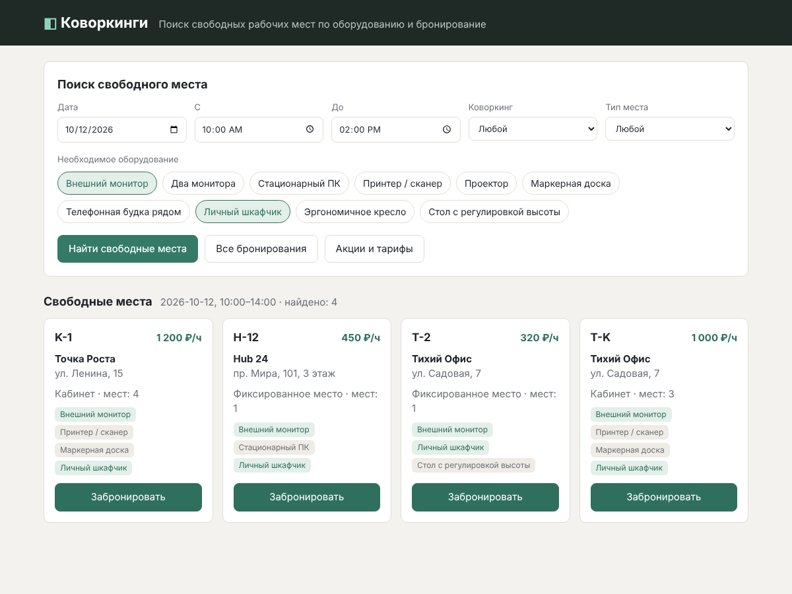
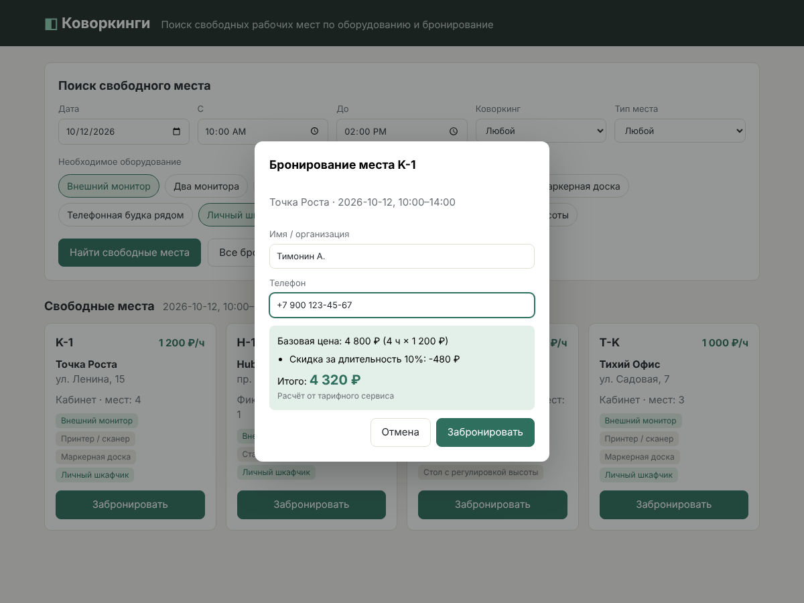
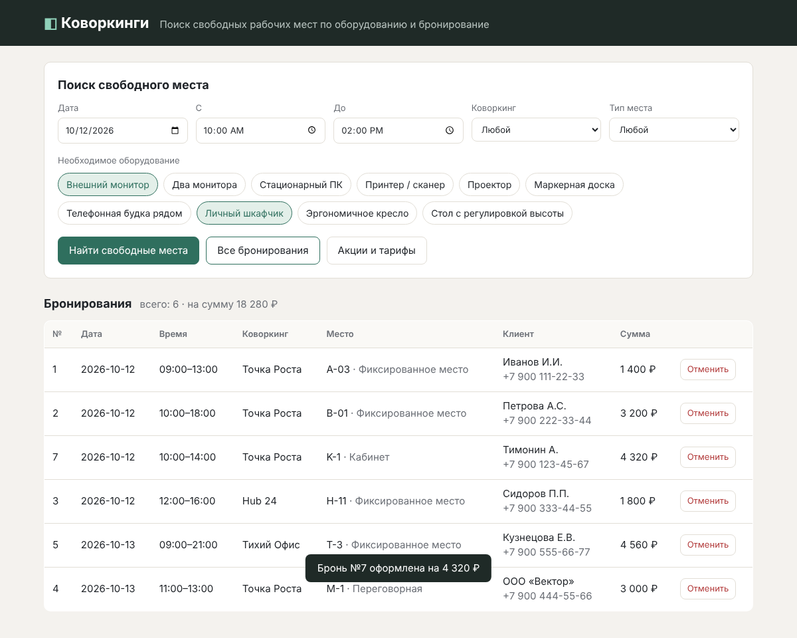
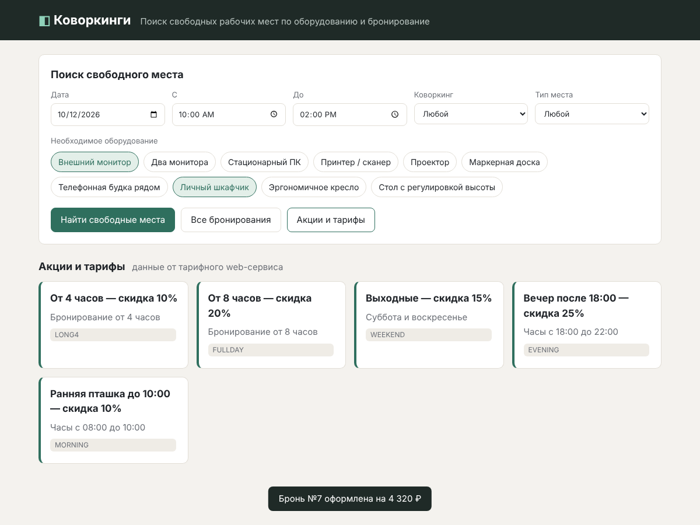

# Коворкинги — поиск и бронирование рабочих мест

Лабораторная работа «Контейнеризация многокомпонентных приложений с помощью Docker Compose».

**Вариант:** Коворкинги — поиск свободных рабочих мест по оборудованию, бронирование рабочих мест.



## Запуск

Нужен только Docker (с Docker Compose v2).

```bash
git clone <ссылка-на-репозиторий>
cd coworking-booking
docker compose up -d --build
```

Открыть в браузере: **http://localhost:8080**

Остановить: `docker compose down` (данные БД сохранятся в volume `db_data`).
Сбросить БД к начальным данным: `docker compose down -v`.

Настройки (логин/пароль БД, порт фронтенда) можно переопределить в файле `.env` — пример в `.env.example`. Без `.env` используются значения по умолчанию.

## Архитектура

```
 Браузер ──► frontend (nginx :80 → хост :8080)
                │  /api/*
                ▼
             backend (Node.js + Express :4000) ──► web-service (тарифы, Node.js :5000)
                │
                ▼
             db (PostgreSQL 16, volume db_data)
```

| Сервис        | Технологии              | Назначение |
|---------------|-------------------------|------------|
| `frontend`    | HTML/CSS/JS, nginx      | Веб-интерфейс; nginx раздаёт статику и проксирует `/api` на backend |
| `backend`     | Node.js 22, Express, pg | REST API: поиск, CRUD бронирований, обращение к тарифному сервису |
| `db`          | PostgreSQL 16           | Коворкинги, места, оборудование, бронирования. Инициализация — `db/init.sql` |
| `web-service` | Node.js 22 (без зависимостей) | Микросервис тарифов: расчёт стоимости со скидками и список акций |

Все сервисы в одной bridge-сети `app-net`. `backend` стартует только после того, как `db` и `web-service` прошли `healthcheck`.

## Возможности интерфейса

- **Найти свободные места** — фильтр по дате, времени, коворкингу, типу места и набору оборудования (место должно иметь *всё* выбранное). Исключаются места, у которых есть пересекающаяся бронь, и коворкинги, закрытые в это время.
- **Забронировать** — у карточки места; стоимость со скидками рассчитывает тарифный web-сервис. Двойное бронирование одного места на пересекающееся время запрещено.
- **Все бронирования** — таблица из БД с возможностью отмены.
- **Акции и тарифы** — данные от web-сервиса.

## REST API (backend)

| Метод | Путь | Описание |
|-------|------|----------|
| GET | `/api/health` | Проверка связи с БД |
| GET | `/api/coworkings` | Список коворкингов |
| GET | `/api/equipment` | Справочник оборудования |
| GET | `/api/workspaces/free?date=&start=&end=&equipment=monitor,locker&coworking_id=&type=` | Свободные места |
| GET | `/api/bookings?date=` | Список бронирований |
| POST | `/api/bookings` | Создать бронь `{workspace_id, client_name, client_phone, date, start, end}` |
| DELETE | `/api/bookings/:id` | Отменить бронь |
| GET | `/api/quote?workspace_id=&date=&start=&end=` | Расчёт стоимости (через web-service) |
| GET | `/api/promos` | Акции (через web-service) |

## Структура проекта

```
coworking-booking/
├── docker-compose.yml
├── .env.example
├── db/init.sql               # схема + начальные данные
├── backend/                  # REST API
│   ├── Dockerfile
│   ├── package.json
│   └── server.js
├── tariff-service/           # web-service по варианту
│   ├── Dockerfile
│   └── server.js
├── frontend/
│   ├── Dockerfile
│   ├── nginx.conf
│   └── public/ (index.html, style.css, app.js)
└── docs/                     # скриншоты
```

## Скриншоты

| Бронирование | Список бронирований | Акции |
|---|---|---|
|  |  |  |
